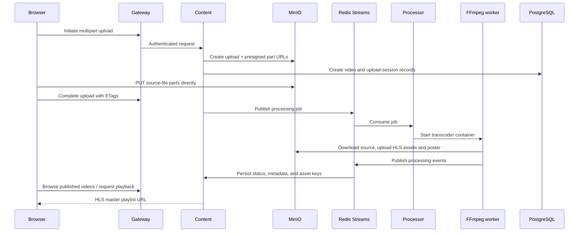

# Streamline Video Platform — Backend

Streamline is a backend-led, event-driven video platform built to demonstrate a modern streaming workflow. A browser uploads a source video directly to object storage in multipart chunks; workers create adaptive HLS renditions and a poster image; the application exposes the published stream through a catalogue.

This is a portfolio project, not a production service. Its implementation makes the processing pipeline visible.

## What it demonstrates

- API gateway routing and JWT-based identity propagation
- User registration, sign-in, profiles, Prisma, and PostgreSQL
- Direct-to-object-storage multipart uploads, not proxying large files through an API
- Redis Streams for asynchronous work dispatch
- Disposable Docker workers for media processing
- FFmpeg HLS packaging at 240p, 360p, 480p, 720p, and 1080p
- Processing-state persistence, metadata extraction, thumbnails, and adaptive playback

## Documentation map

| Document | Use it for |
| --- | --- |
| [Architecture](docs/architecture.md) | System design, responsibilities, storage, and flows |
| [Local development](docs/local-development.md) | Configuration, startup, and verification |
| [API reference](docs/api-reference.md) | HTTP contracts and response envelopes |
| [Event contracts](docs/event-contracts.md) | Redis Streams, stages, and state transitions |


## Services

| Component | Technology | Responsibility |
| --- | --- | --- |
| API Gateway | Express + TypeScript | Public edge, JWT validation, request forwarding |
| User Service | Express + Prisma | User credentials, JWT issuance, profiles |
| Content Service | FastAPI + SQLAlchemy | Upload sessions, video metadata, playback URLs, processing events |
| Video Processing Service | Python + Docker SDK | Redis consumer that starts isolated transcoder jobs |
| Video Transcoder | Python + FFmpeg | Download, inspect, transcode, package HLS, upload assets, emit events |
| PostgreSQL / Redis / MinIO | Infrastructure | Records / queues and ephemeral state / object storage |

## Quick start

1. Complete the configuration checklist in [Local development](docs/local-development.md).
2. From this directory, start backend services:

   ```bash
   docker compose up --build
   ```

3. From `../netflix_frontend`, start the client:

   ```bash
   npm install
   npm run dev
   ```

The gateway normally listens on `http://localhost:3000`; Vite normally uses `http://localhost:5173`.

## End-to-end lifecycle



## Important MVP boundaries

- The video and thumbnail buckets are public for local testing. Production should use a private origin plus a CDN or signed URLs.
- The content service trusts gateway-provided user headers. Expose only the gateway to clients in a production deployment.
- The processing service mounts the host Docker socket to launch workers. Replace it with a constrained job runner before production.
- Automated tests and CI are planned rather than complete; see the operations guide.
