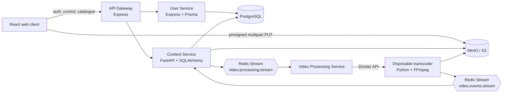

# Architecture

## Design goals

The platform separates latency-sensitive HTTP work from CPU-heavy media work. APIs create and track jobs; asynchronous workers process media; object storage carries large binaries. The gateway and content API therefore never proxy the source video itself.

## Component diagram

## Service boundaries

### API Gateway

The gateway validates Bearer JWTs on protected routes, adds `x-user-id`, `x-user-email`, and `x-user-role` for downstream services, and forwards requests. Published catalogue and playback routes are public; upload and personal video-management routes are protected.

### User Service

Owns user credentials and profiles in PostgreSQL. Passwords are bcrypt-hashed. Registration and sign-in issue JWTs containing id, email, and role. Profile calls rely on identity headers from the gateway.

### Content Service

Owns video and upload-session records. It creates S3-compatible multipart uploads, returns presigned URLs, completes them from ETags, publishes jobs, and consumes worker events to materialize processing state and media metadata.

### Video Processing Service

Consumes `video:processing:stream`. Each job creates a named `transcoder-<video-id>` container on the configured Docker network. It orchestrates work; it does not transcode media itself.

### Video Transcoder

Downloads the source, extracts metadata, creates concurrent HLS renditions, produces a master playlist and poster, uploads assets, reports Redis progress, emits lifecycle events, and cleans temporary files.

## Data ownership

| Data | System of record | Notes |
| --- | --- | --- |
| Users, roles, credentials | User Service PostgreSQL schema | Passwords are never returned by profile APIs |
| Videos and upload sessions | Content Service PostgreSQL schema | State is updated from worker events |
| Source video | `S3_TEMP_BUCKET` | Multipart source object |
| HLS playlists and segments | `S3_VIDEO_BUCKET` | Public in the local MVP |
| Posters | `S3_THUMBNAIL_BUCKET` | Public in the local MVP |
| Jobs/events | Redis Streams | Consumer-group delivery, not a long-term audit store |
| Fine-grained progress | Redis hash `video:status:<video-id>` | One-hour default TTL |

## State and production boundaries

The intended database state model is `UPLOADING` → `QUEUED` → `PROCESSING` → `COMPLETED` or `FAILED`. `current_stage` supplies the detail while a worker runs. Processing stages are documented in [Event contracts](event-contracts.md).

The local MVP uses public media buckets and gateway-propagated identity headers. In production, make internal services private, authenticate service-to-service calls, use a private media origin/CDN, enforce upload-session ownership, and move infrastructure provisioning out of application startup.
