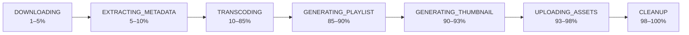

# Event contracts and media pipeline

## Streams

| Stream | Producer | Consumer | Purpose |
| --- | --- | --- | --- |
| `video:processing:stream` | Content Service | Video Processing Service | A completed multipart source is ready for a worker |
| `video:events:stream` | Video Transcoder | Content Service | Persist lifecycle, stage, completion, and failure state |

Both consumers use Redis consumer groups. Consumer/group names and stream names are environment-configurable.

## Processing job

After a multipart upload completes, Content Service publishes a job with these meaningful fields:

```json
{
  "video_id": "uuid",
  "upload_path": "uploads/<uuid>_source.mp4",
  "user_id": "uuid",
  "title": "Demo video",
  "thumbnail_object_key": null
}
```

The processing service validates the event and starts `transcoder-<video-id>`, passing `VIDEO_ID` and `UPLOAD_PATH` as environment variables.

## Domain events

Every transcoder event includes `event_type` plus the event payload.

| Event type | Payload | Content-service effect |
| --- | --- | --- |
| `VIDEO_PROCESSING_STARTED` | `video_id` | Mark video `PROCESSING`, stage `DOWNLOADING`, record start time |
| `VIDEO_PROCESSING_STAGE_CHANGED` | `video_id`, `current_stage` | Update `current_stage` |
| `VIDEO_PROCESSING_COMPLETED` | asset keys, duration, dimensions, file size, MIME type | Mark completed and persist playback/metadata fields |
| `VIDEO_PROCESSING_FAILED` | `video_id`, stage, error | Mark failed, persist error, increment retry count |

## Processing stages



The worker stores progress in a Redis hash keyed as `video:status:<video-id>`. The default hash TTL is one hour; terminal status has a ten-minute TTL. The browser currently reads database state through `/videos/mine`, not this Redis hash.

## HLS output

The transcoder creates five variants:

| Variant | Scale | Video bitrate |
| --- | --- | --- |
| 240p | 426×240 | 400k |
| 360p | 640×360 | 800k |
| 480p | 854×480 | 1400k |
| 720p | 1280×720 | 2800k |
| 1080p | 1920×1080 | 5000k |

Each variant has an `index.m3u8` playlist and HLS `.ts` segments. The master playlist references variants, and `poster.jpg` is captured at 20% of source duration. Assets are uploaded to the video and thumbnail buckets respectively.

## Reliability considerations

- Consumer retries are configured, but jobs are not yet idempotent. A duplicate event can attempt to create the same worker container.
- `auto_remove=False` leaves worker containers available for inspection but needs a cleanup/reconciliation policy.
- A dead-letter stream, explicit job records, and idempotency key would make failure recovery auditable.
- Progress events are throttled by a percentage threshold and a five-second interval to avoid excessive Redis writes.
